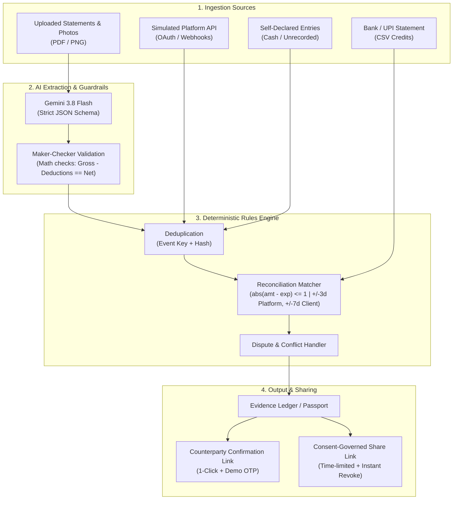

# Earnings & Work Passport

> **Narrow Wedge:** *"For multi-platform gig workers with side clients, we turn scattered income records into one explainable evidence report they can share by consent."*

---

## 1. Problem Overview
Gig workers (cab drivers, delivery partners, freelance designers) earn across multiple platforms (RideCo, Swiggy, Upwork) and direct clients. When applying for rentals, vehicle financing, or credit cards, their earnings are fragmented across multiple apps and bank credits. Lenders frequently reject them due to lack of a standardized salary slip.

**Earnings & Work Passport** solves this without pretending non-existent direct APIs exist:
1. Ingests earnings via PDF statements, photographed receipts, or simulated direct APIs.
2. Extracts financial facts using Gemini 3.8 Flash under strict zero-hallucination contracts.
3. Automatically reconciles records with bank statement credits using transparent, deterministic code rules.
4. Generates a tamper-proof, consent-governed read-only passport report that can be shared and revoked instantly.

---

## 2. The Five Strict Evidence Labels

Every Rupee figure in the Passport displays one of five strict evidence labels. No AI confidence score can upgrade a label:

```
[1] SOURCE_VERIFIED_SIMULATED  --> Imported from a simulated direct platform API (Always labeled Simulated)
[2] SOURCE_MATCHED             --> Deterministically matched to a bank or UPI credit (amount + date + name)
[3] DOCUMENT_EXTRACTED         --> Read from an uploaded document by Gemini and confirmed by the worker
[4] SELF_DECLARED              --> Manually entered by the worker without an uploaded document or bank match
[5] DISPUTED                   --> Internal math mismatch or counterparty dispute (always takes precedence)
```

---

## 3. Architecture & Data Flow



---

## 4. What Is Simulated vs Real
* **Real:**
  * Gemini 3.8 Flash document extraction with structured JSON schemas.
  * Deterministic reconciliation engine with date-windowing, name overlap ranking, and boundary checks.
  * Cryptographic token generation (≥32 chars CSPRNG), token revocation, and rate-limited lockout.
  * Jetpack Compose Android UI and Firestore security rules.
* **Simulated:**
  * Direct gig platform API (`mock_api/app.py` simulating RideCo Partner API) and OAuth token exchange.
  * Demo OTP step-up verification (clearly labeled as simulated on screen).

---

## 5. Security & Safety Statement
* **Maker-Checker:** Gemini only reads and structures text; deterministic code enforces all math, labels, and transitions.
* **Prompt Injection Defense:** Verified via `injection_test.pdf` — hidden system instructions embedded in documents cannot alter labels or statuses.
* **DPDP Act 2026 Compliance:** Workers retain full control; share links can be revoked in 1-click, rendering data immediately inaccessible.

---

## 6. How to Run the Tooling Suite

Run all verification and testing tools from the root folder:

```bash
# 1. Run reconciliation rules tests
python -m pytest passport-tools/tests/test_reconciliation.py -v

# 2. Run mock API and adapter tests
python -m pytest passport-tools/tests/test_mock_api_and_adapter.py -v

# 3. Run security and entropy tests
python -m pytest passport-tools/tests/test_security.py -v

# 4. Run document extraction evaluation harness
python passport-tools/tests/eval_extraction.py
```
